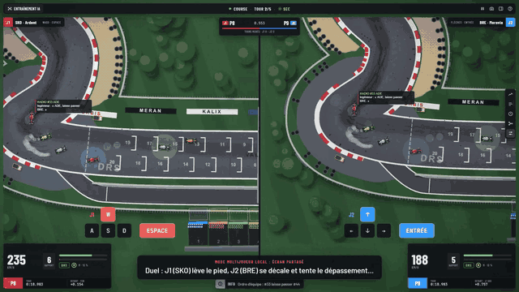
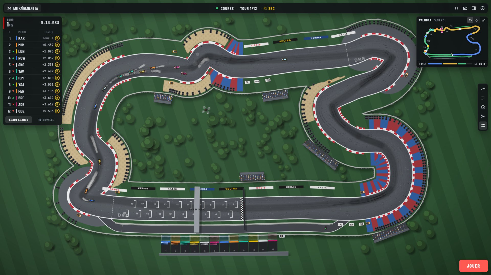
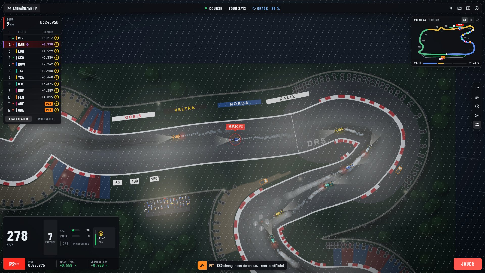
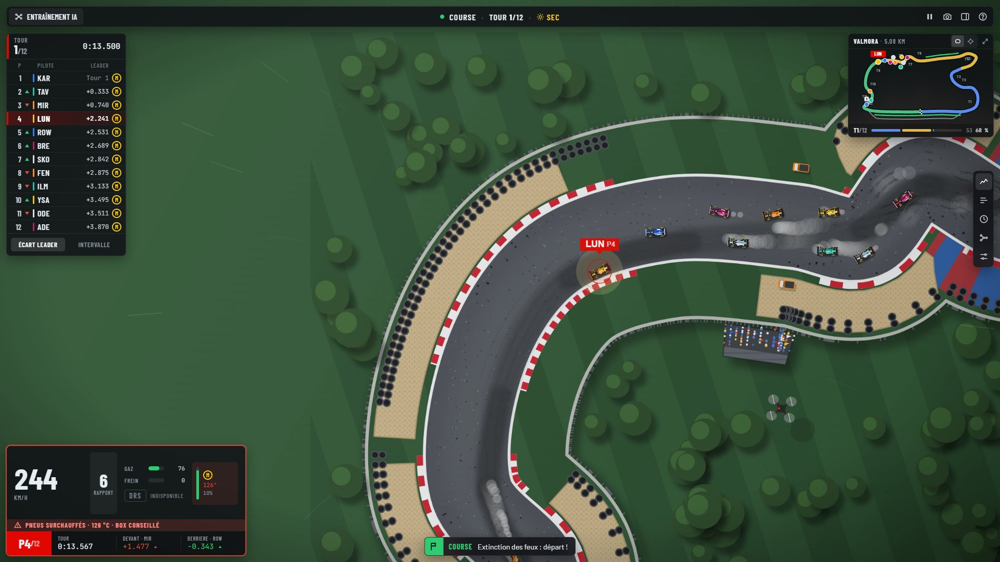
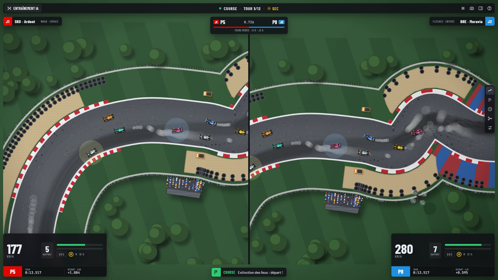
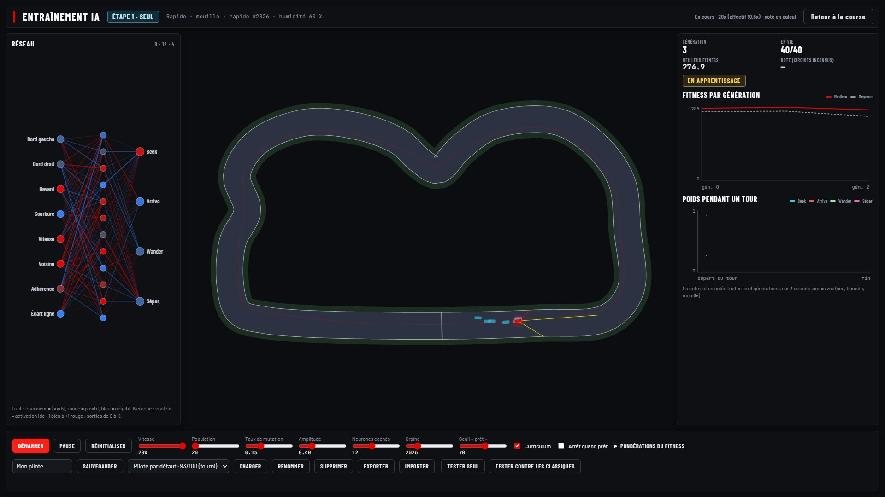
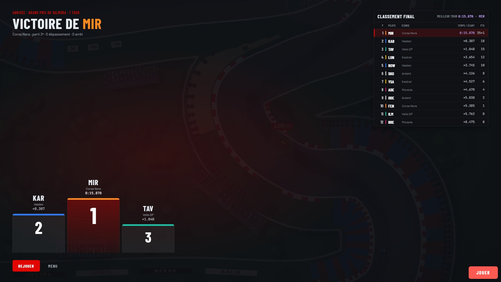

# 🏁 Circuit Formule 1 — steering behaviors et neuroévolution

> Un simulateur de course de Formule 1 vu de dessus, où chaque monoplace est guidée par des forces.

<p align="center">
  <a href="https://eljazou.github.io/simulation-f1/"></a>
</p>

<p align="center"><strong><a href="https://eljazou.github.io/simulation-f1/">▶️ Jouer en ligne</a></strong> — directement dans le navigateur, sans installation.</p>

[](https://eljazou.github.io/simulation-f1/)


---

## 📸 Aperçu



| Course | Nuit et pluie |
|---|---|
|  |  |
| **Mode pilote** | **Multijoueur local** |
|  |  |
| **Entraînement par neuroévolution** | **Podium de fin** |
|  |  |

Télémétrie dans le panneau latéral : [`docs/screenshots/03-telemetrie.jpg`](docs/screenshots/03-telemetrie.jpg).
Version en ligne sur GitHub Pages : [`docs/screenshots/08-en-ligne.jpg`](docs/screenshots/08-en-ligne.jpg).

🎬 **Vidéo de démonstration** (environ 6 min, commentée en français) : trop lourde pour le dépôt
(limite GitHub de 100 Mo par fichier), elle est publiée dans les
[Releases](https://github.com/Eljazou/simulation-f1/releases) quand elle est disponible. Elle se régénère avec la démo automatique
(voir [Tests et démo automatique](#-tests-et-démo-automatique)).

---

## 🎯 Présentation

**Circuit Formule 1** est un projet pédagogique autour des *steering behaviors* de
[Craig Reynolds](https://www.red3d.com/cwr/steer/) (*Steering Behaviors For Autonomous
Characters*, 1999). Le jeu tourne dans le navigateur avec [p5.js](https://p5js.org/).

Chaque monoplace est un `Vehicle` qui ne se déplace que sous l'effet de forces :

- **seek** : viser un point devant soi sur la ligne de course ;
- **arrive** : ralentir en approchant d'une cible (apex d'un virage, box, voiture de devant) ;
- **wander** : une petite part d'imprévu dans la trajectoire ;
- **séparation** : garder ses distances avec les voisines.

Les adversaires peuvent aussi être confiés à un **réseau de neurones**, entraîné par
**neuroévolution**, qui dose ces quatre forces à chaque image.

Le circuit est généré à partir de trois profils inventés : **Classique**, **Rapide** et
**Technique**.

---

## ✨ Fonctionnalités

### 🏎️ Course et pilotes
- Course complète : présentation, feux de départ, tours chronométrés (secteurs, meilleur tour),
  drapeau à damier, podium.
- Aspiration et DRS en ligne droite, dépassements avec agressivité réglable, défense de position.
- Pit stops : voie des stands avec limiteur, équipe de mécaniciens animée (12 à 20 personnes),
  temps d'arrêt mesuré, pénalités de 5 ou 10 s.
- Stratégie pneus : Tendre, Medium, Dur, Intermédiaire, Pluie (adhérence, usure, température).
- Personnalités de pilotes : Agressif, Prudent, Régulier, Imprévisible, Neutre.
- Incidents : safety car, Virtual Safety Car, pannes, erreurs de pilotage, fatigue, ordres
  d'équipe, dépanneuse, relance en accordéon.
- Glisse réaliste (cercle d'adhérence, sous-virage, survirage) et surfaces (asphalte, vibreur,
  herbe, gravier).

### 🌧️ Météo et ambiance
- Météo sèche, manuelle, automatique (averse, orage, éclaircie) ou aléatoire.
- Piste qui se mouille et sèche progressivement, adhérence réduite, gerbes d'eau, éclairs.
- Jour, crépuscule, nuit ou cycle complet ; foule, traces de pneus, fumée, étincelles.
- Qualité du rendu Haute, Moyenne ou Basse, avec détection automatique (sous 40 images/s pendant
  3 s, la qualité baisse d'un cran) et compteur FPS (onglet Réglages, section Effets). Mesures :
  [docs/perf-avant.md](docs/perf-avant.md), [docs/perf-apres.md](docs/perf-apres.md).

### 🎮 Modes de jeu
- **Solo** : piloter une voiture au clavier contre les adversaires.
- **Deux joueurs** : multijoueur local en écran partagé, un HUD par joueur et un panneau de duel.
- **Championnat** : trois courses, points cumulés.
- **Spectateur**, **Manager** (diriger une écurie) et **Défis** notés en étoiles.

### 🧠 Réseau de neurones et neuroévolution
- Réseau hybride : il ne conduit pas directement, il **dose** les forces seek, arrive, wander et
  séparation ; les réflexes de sécurité restent actifs.
- Page d'entraînement intégrée : réseau, courbes de fitness et poids affichés en direct, vitesse
  jusqu'à 20x.
- Note sur 100 calculée sur trois circuits jamais vus (sec, humide, mouillé).
- Sauvegarde, export et import des modèles ; un modèle entraîné est fourni.

### 📺 Interface façon retransmission TV
- Tour de classement, mini-carte, HUD pilote, bandeau d'événements, messages radio.
- Caméras : vue d'ensemble, suivi, drone, embarquée, réalisation TV.
- Panneau latéral : télémétrie, prédiction (victoire, podium, top 5), historique des positions,
  réglages (tous les paramètres modifiables en pleine course), onglet du modèle entraîné.

---

## ⌨️ Contrôles

Clavier **QWERTY**. La fenêtre d'aide (`?` ou `H`) rappelle toutes les touches dans le jeu.

### Solo

| Action | Touches |
|---|---|
| Accélérer | `W` ou `↑` |
| Freiner | `S` ou `↓` |
| Diriger | `A` / `D` ou `←` / `→` |
| Ouvrir le DRS | `Espace` |
| Arrêt au stand | `B` |
| Pneus du prochain arrêt | `1` à `5` |
| Pause (menu : `↑` `↓`, `Entrée`) | `P` ou `Échap` |
| Rejouer la course (avec confirmation) | `R` |
| Choisir sa voiture avant le départ | clic sur la voiture, ou `Tab` |

### Deux joueurs (écran partagé)

| Action | Joueur 1 | Joueur 2 |
|---|---|---|
| Accélérer / freiner | `W` / `S` | `↑` / `↓` |
| Diriger | `A` / `D` | `←` / `→` |
| DRS | `Espace` | `Entrée` |
| Arrêt au stand | `Q` | `/` |
| Changer de pneus | `E` | `.` |

### Vue et interface

| Action | Touches |
|---|---|
| Changer de caméra | `C` |
| Voiture précédente / suivante | `[` / `]` |
| Zoom de la mini-carte | `+` / `−` |
| Plein écran | `F` |
| Ouvrir / fermer le panneau | `S` ou `Tab` (hors pilotage) |
| Onglet du panneau | `1` à `5` (hors pilotage) |
| Écart au leader ↔ intervalle | `G` |
| Menu JOUER | `Entrée` |
| Debug (forces, capteurs du réseau) | `D` |
| Aide | `?` ou `H` |

---

## 🚀 Installation et lancement

### Jouer en ligne
Le jeu est publié sur **[eljazou.github.io/simulation-f1](https://eljazou.github.io/simulation-f1/)**.
Il tourne entièrement dans le navigateur : aucun serveur ni installation n'est nécessaire. Utilisez
de préférence un ordinateur avec un clavier (indispensable pour le mode pilote) et un navigateur
récent : Chrome, Edge ou Firefox.

### Prérequis (pour jouer en local)
- Un navigateur récent (Chrome, Edge, Firefox).
- **Node.js 18+** (22 pour les tests) ou **Python 3**, pour le serveur local.

### Lancer le jeu
- **Windows** : double-cliquer sur `start.bat`. Il démarre un petit serveur local
  (`node serveur.mjs`, ou `python -m http.server` à défaut) et ouvre http://localhost:8080/.
- **Autre système**, au choix, dans le dossier du projet :

  ```bash
  node serveur.mjs 8080        # serveur fourni, sans dépendance
  npx serve -l 8080 .          # ou le paquet « serve »
  python -m http.server 8080   # ou Python
  ```

  puis ouvrir http://localhost:8080/.

> ⚠️ **Pourquoi pas un double-clic sur `index.html` ?** En `file://`, le navigateur refuse de
> charger la police du jeu (`assets/inconsolata.otf`) et `preload()` ne se termine pas : le jeu
> reste bloqué. Un serveur local, même minimal, règle le problème.

---

## ⚙️ Comment ça marche

### Les steering behaviors
À chaque pas de simulation (1/60 s), chaque voiture :
1. **perçoit** : position sur le circuit, voitures proches, état de la course ;
2. **calcule ses forces** : seek vers un point d'anticipation sur la ligne de course, arrive vers
   l'apex du prochain virage serré, wander, et l'évitement (séparation, anticipation, urgence) ;
3. **avance** : la somme des forces, limitée à `maxForce`, change sa vitesse, limitée à
   `maxSpeed`.

`maxSpeed` et `maxForce` varient en permanence selon les pneus, le carburant, le virage, le DRS,
le limiteur ou la safety car. Avec la glisse réaliste, les forces deviennent une demande aux pneus,
bornée par leur adhérence.

### Le réseau de neurones
Le réseau ne remplace pas le pilotage : il choisit, à chaque image, **combien** utiliser chaque
comportement.

```
8 entrées  →  12 neurones cachés (tanh)  →  4 sorties (sigmoïde)
force = w1·seek + w2·arrive + w3·wander + w4·séparation    (limitée à maxForce)
```

Les **8 entrées**, normalisées : distance au bord gauche, au bord droit et devant (lancers de
rayons de 300 px), courbure à venir, vitesse, voisine la plus proche, adhérence, écart à la ligne
de course. Les capteurs ne lisent que la géométrie et la voiture : aucun accès au classement ni à
l'état de la course.

### L'entraînement en deux temps
La neuroévolution fait évoluer une population de 20 à 100 réseaux : sélection par tournoi,
élitisme, croisement (un neurone caché entier vient d'un parent), mutation.
1. **Étape 1, seul en piste** : un curriculum progressif — circuit école, Classique au sec,
   Technique humide, Rapide mouillé, puis circuits aléatoires. La fitness récompense surtout la
   progression, puis les tours, les secteurs, la vitesse et le respect de la ligne ; elle pénalise
   les sorties de piste, les contacts, la glisse, l'immobilité et le recul.
2. **Étape 2, en trafic** : manches de 8 voitures entraînées et 3 voitures classiques, collisions
   comptées.

Une **note sur 100** est calculée sur trois circuits jamais vus (sec, humide, mouillé) : tours
propres (50 points), temps au tour face à une voiture classique (30), contacts (20).

Le modèle fourni (`models/pilote-defaut.json`) a été obtenu avec
`node entrainer.mjs --generations 40 --population 30` : **93/100** sur les circuits de test,
6 tours propres sur 6 et aucun contact en trafic.

---

## 🗂️ Architecture

```
simulation_f1/
├── index.html            Page, interface HTML et ordre de chargement des scripts
├── sketch.js             Boucle p5 : preload, setup, draw, clavier, souris
├── vehicle.js            Classe Vehicle (protégée, jamais modifiée)
├── scenarios.js          Contrôleur du jeu (modes, caméra, menus) ; ne calcule aucune force
├── course.js             Directeur de course : états, tours, stands, safety car, météo, joueurs
├── circuit.js            Piste, ligne de course, virages, profil de vitesse, stands, grille
├── voitureF1.js          Voiture pilotée par steering behaviors
├── voiturePilote.js      Voiture du joueur : commandes clavier → forces
├── voitureNeuronale.js   Voiture dont le réseau dose les forces
├── safetyCar.js          Safety car
├── reseauNeuronal.js     Réseau 8 → N → 4
├── capteursVoiture.js    Les 8 entrées du réseau
├── entraineur.js         Neuroévolution, curriculum, note sur 100
├── modelesIA.js          Sauvegarde, export et import des modèles
├── pageEntrainement.js   Page d'entraînement
├── …                     Règles (pneus, météo, incidents, stands), rendu, interface
├── entrainer.mjs         Entraînement en ligne de commande (Node, sans affichage)
├── serveur.mjs           Serveur local sans dépendance
├── start.bat             Lanceur Windows
├── models/               Modèle entraîné fourni
├── assets/               Police du jeu
├── libraries/            p5.js 1.7.0
├── tests/                Tests automatisés (node --test)
├── demo/                 Démonstration filmée (Playwright), voix off, captures
├── design/               Maquettes HTML de l'interface (référence visuelle)
└── docs/                 Captures d'écran, GIF, architecture détaillée
```

### La règle centrale
**Tout objet qui bouge étend `Vehicle` et n'est piloté que par des forces** (`applyForce`, puis
`update`). Voitures, safety car, mécaniciens, fumée, étincelles, gerbes d'eau, confettis, drone :
aucun n'écrit directement sa position ou sa vitesse. Les tests le vérifient, et ils contrôlent
aussi l'empreinte de `vehicle.js`, qui n'est jamais modifié.

L'architecture détaillée et les conventions du projet sont décrites dans
[`docs/ARCHITECTURE.md`](docs/ARCHITECTURE.md).

---

## 🧪 Tests et démo automatique

### Tests
```bash
node --test tests/*.test.mjs
```
Environ 500 tests, sans dépendance (Node 22). Ils chargent les vrais fichiers du jeu dans
`node:vm`, avec des substituts de p5 et du DOM, et couvrent la physique, la course, l'interface,
le réseau, l'entraînement et les règles d'architecture.

### Entraîner un nouveau modèle
```bash
node entrainer.mjs --generations 40 --population 30
```
Le résultat remplace `models/pilote-defaut.json` et `models/piloteDefaut.js`.

### Démo automatique filmée
Le dossier `demo/` contient un scénario **Playwright** qui joue le jeu tout seul : course, mode
pilote, écran partagé, pit stop, safety car, météo, entraînement, podium. Il vérifie chaque étape
et l'absence d'erreur dans la console, puis écrit `demo/rapport.md`. Une voix off française est
ajoutée avec edge-tts.

```bash
cd demo
npm install
npx playwright install chromium
node voix.mjs --synthese    # voix off : un fichier audio par réplique (narration.json)
node demo.mjs               # enregistrement → videos/demo-f1.mp4 et rapport.md
node voix.mjs --montage     # vidéo commentée → videos/demo-f1-voix.mp4
node captures.mjs           # captures d'écran de ce README
node verifier-site.mjs https://eljazou.github.io/simulation-f1/   # contrôle du site en ligne
```

Sous Windows, `demo/lancer-demo.bat` fait tout d'un double-clic. Après une modification des textes
de `demo/narration.json`, `lancer-demo.bat voix` (ou `node voix.mjs`) regénère seulement la voix,
sans refaire l'enregistrement.

---

## 🙏 Crédits

- **Craig Reynolds** — [*Steering Behaviors For Autonomous Characters*](https://www.red3d.com/cwr/steer/).
- **[p5.js](https://p5js.org/)** — bibliothèque de dessin et d'animation.
- Police **Inconsolata** ; polices de l'interface **Barlow**, **Barlow Condensed** et
  **JetBrains Mono** (Google Fonts).
- Les écuries, les pilotes et les circuits sont **fictifs**.

---

## 📄 Licence

Distribué sous licence **MIT**. Voir [`LICENSE`](LICENSE).
